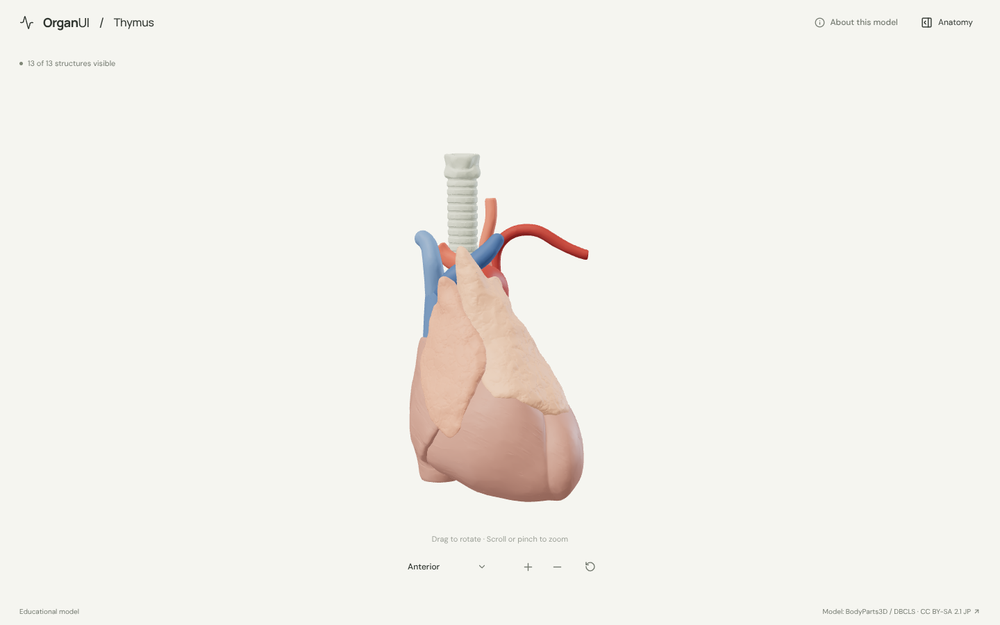
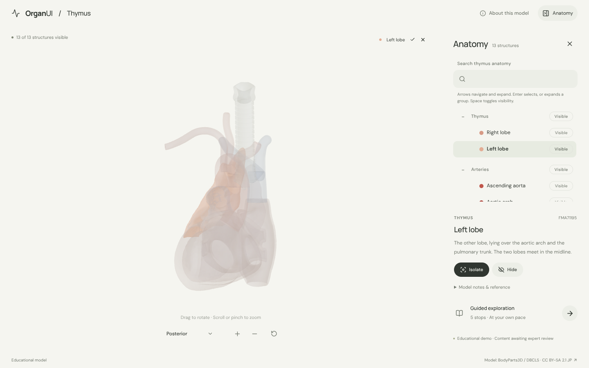
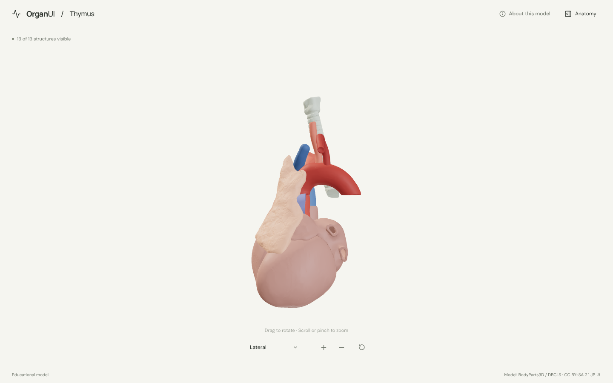
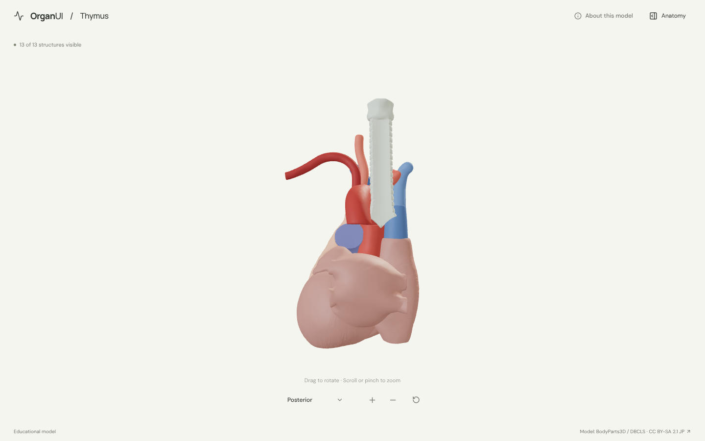
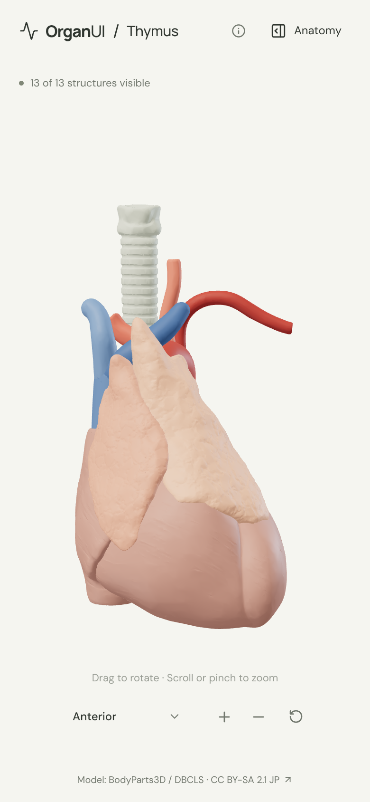

# OrganUI Thymus

A minimal, standalone, open-source explorer of the thymus and the structures around it, built with React, TypeScript, Three.js, React Three Fiber, Vite, and Bun. It shares its interaction design and code with [OrganUI Heart](https://github.com/organui/heart-3d).

**Status:** working local demo. Thirteen selectable structures from a real, openly licensed model, responsive layouts, and checked desktop/mobile interactions. Public deployment and clinical anatomy review have not been completed.



## Run locally

Install [Bun](https://bun.sh/) **1.4.2 or newer**, then:

```sh
git clone https://github.com/organui/thymus-3d.git
cd thymus-3d
bun install --frozen-lockfile
bun run dev
```

Open **http://127.0.0.1:5173**. No environment variables, accounts, API keys, sibling repositories, model downloads, or external font services are needed after dependency installation. The ready-to-use 4.2 MB GLB is in `public/models/`.

```sh
bun run typecheck       # TypeScript checks, including conversion scripts
bun run test            # Unit tests for selection emphasis, picking, ownership, and the anatomy-tree adapter
bun run verify:model    # Check the GLB hash, source IDs, element lists, and valid geometry
bun run measure:alignment # Re-measure the pinned 4.3-to-3.0 shifts (needs the source downloads)
bun run build           # Typecheck and create dist/
bun run preview         # Serve the production build at http://127.0.0.1:4173
bun run format:check    # Check formatting
```

The app is static and uses relative build paths. No deployment has been performed.

## Explore

- The model opens from the front: the two lobes of the thymus draped over the great vessels, with the heart below and the trachea above. The sternum, ribs and lungs are left out so the gland is not hidden. Open **Anatomy** in the header to browse structures.
- Drag to rotate; scroll or pinch to zoom. The view menu has anterior, lateral (from the left side) and posterior presets. Manual rotation changes its label to **Custom view**; zooming and selecting keep the view name.
- Select a mesh or use the anatomy tree (the OrganUI registry `anatomy-tree` component, see [registry integration](docs/REGISTRY_INTEGRATION.md)). The selected structure glows in its own colour and everything else is ghosted, so the thymus stays visible from behind through the trachea and vessels.
- Isolate a structure, hide it, or restore all. **Reset explorer** restores the anterior camera, visibility, selection, tree state and tour.
- Follow five guided stops: the thymus behind the breastbone, the left lobe over the aortic arch, the left brachiocephalic vein, the view from behind, and how the gland changes with age.
- Keyboard: Tab/Enter for controls, arrow keys to rotate the focused model, `+`/`-` to zoom, Escape closes the panel and returns focus to its toggle.

<details>
<summary>Selection, lateral, posterior and mobile screenshots</summary>









</details>

## Model, credits, and license

> BodyParts3D / Anatomography, © The Database Center for Life Science (DBCLS), licensed under Creative Commons Attribution-Share Alike 2.1 Japan. Adapted by OrganUI.

The model is a curated subset of **BodyParts3D 3.0** (the thymus, aorta and branches, great veins and trachea) and **BodyParts3D / Anatomography 4.3** (the heart walls and pulmonary trunk): 15 source meshes grouped into 13 structures. In the chest the 4.3 meshes sit about 1 cm lower than the 3.0 ones, so the heart and pulmonary trunk are moved onto their 3.0 counterparts by a measured, pinned translation. The model data and screenshots of it are under **[CC BY-SA 2.1 Japan](https://creativecommons.org/licenses/by-sa/2.1/jp/deed.en)**, separately from this repository's **MIT code license**. Meshes come from two checksum-pinned public mirrors and are cross-checked against each release's own concept list. Read [model provenance](docs/MODEL_PROVENANCE.md), [asset attribution](public/models/ATTRIBUTION.md) and the [manifest](public/models/manifest.json).

Descriptions summarise the [NCI SEER Training thymus page](https://training.seer.cancer.gov/anatomy/lymphatic/components/thymus.html) and general anatomy; that page could not be opened from the build sandbox, so the wording has not been checked against it. **Expert anatomical review is pending.** This is an educational interface demonstration, not a diagnostic or clinical tool.

Known limitations:

- Each lobe of the thymus is one mesh. Its lobules, cortex and medulla are not modelled. The source body is an adult, so the gland is smaller than it would be in a child, and its real size and shape vary a lot between people.
- The heart is one structure made of three wall meshes (ventricles, left atrium, right atrium). The pericardium has no mesh in either release.
- The sternum, ribs, lungs, internal thoracic vessels, phrenic nerves and the descending aorta are omitted, as are the right subclavian and right common carotid arteries.
- The thymic veins and the thyroid gland are left out: they exist only in 4.3, and with no 3.0 counterpart their offset could not be measured, so they could not be placed reliably.
- Colours are illustrative.
- Browser checks used headless Chromium with software WebGL at desktop and phone viewport sizes, not physical devices or a screen-reader audit.

## License

Original application code: [MIT](LICENSE). Anatomy model, derived model images, fonts, and icons retain their separately documented licenses.

Part of [OrganUI](https://github.com/organui).
